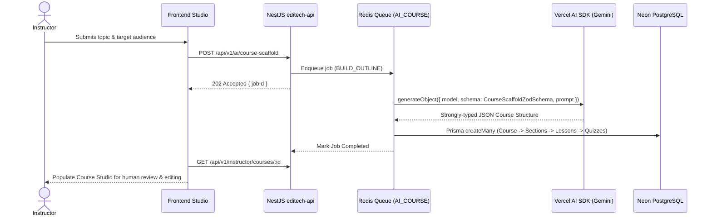
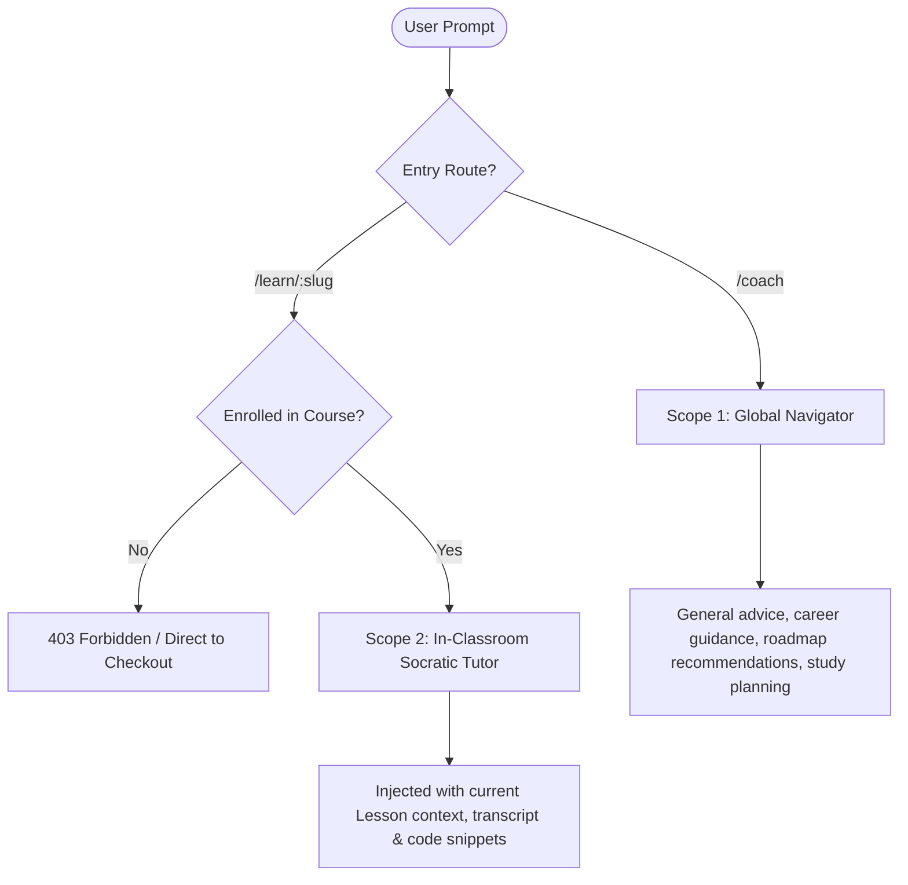

# 02. AI Architecture & Provider Strategy

## 1. Provider Strategy & The Vercel AI SDK

### A. Architectural Decision: Vercel AI SDK (`ai`)
To prevent vendor lock-in and enable zero-friction provider swapping, Editech uses the **Vercel AI SDK (`ai`)** across backend and frontend.

```text
Application Business Logic (Course Builder / Aria Tutor)
                 │
                 ▼
       Vercel AI SDK (`ai`)
       ├── generateText / streamText
       └── generateObject (Zod Schema Validation)
                 │
        ┌────────┴────────┐
        ▼                 ▼
@ai-sdk/google     @ai-sdk/openai / @ai-sdk/anthropic
(Free Dev/Testing)   (Production Deployments)
```

### B. Pre-Launch Development Provider: Google Gemini
* **Provider**: `@ai-sdk/google` via Google AI Studio.
* **Model**: `gemini-1.5-flash` or `gemini-2.0-flash`.
* **Cost**: **$0.00** (Free tier: 15 Requests/Min, 1,500 Requests/Day).
* **Benefits**: 1M+ token context window, fast responses, native structured JSON outputs with Zod.

---

## 2. Feature 1: AI Course Builder (Instructor Studio)

### A. Purpose
Enables instructors to scaffold a complete course outline (title, description, sections, lessons, estimated durations, and quiz questions) from a simple natural language prompt in seconds.

### B. Workflow & BullMQ Integration


---

## 3. Feature 2: Aria (The AI Learning Coach)

### A. The Dual-Scope Model
To prevent content leakage and provide relevant assistance, Aria operates in two distinct modes:



### B. Scope 1: Global Navigator (`/coach`)
* **Role**: Platform concierge, study scheduler, and career guide.
* **Guardrail**: Has **NO access to proprietary course lesson transcripts, code solutions, or quiz answer keys**.
* **Policy**: When asked for answers from paid courses, provides high-level conceptual guidance and prompts the student to enroll.

### C. Scope 2: In-Classroom Socratic Tutor (`/learn/[slug]`)
* **Role**: Coding assistant and conceptual mentor for the active lesson.
* **Security Check**: The backend verifies `enrolments` before injecting lesson context:
  ```typescript
  const enrolment = await prisma.enrolment.findUnique({
    where: { learnerId_courseId: { learnerId, courseId } },
  });
  if (!enrolment) throw new ForbiddenException();
  ```
* **Context Injection**: The backend injects the lesson title, lesson type, text content, and transcript into the system prompt.
* **Persona Support**:
  * **Friendly 😊**: Warm, conversational, beginner-friendly explanations.
  * **Formal**: Technical, precise, standard documentation style.
  * **Socratic**: Asks leading questions to help the student debug rather than writing complete code for them.
* **History Persistence**: Messages are saved in `ai_conversations` table linked to `(learnerId, lessonId)`.

---

## 4. Prompt Engineering & Utility Architecture (`src/modules/ai/prompts/`)

To prevent hardcoded prompts and ensure prompt versioning, testing, and easy tuning, all prompts are decoupled from service logic into dedicated utility files:

```text
src/modules/ai/prompts/
├── course-builder.prompts.ts   # System prompt & parameter builder for curriculum scaffolding
├── tutor.prompts.ts            # System prompt, persona styles (Friendly, Formal, Socratic), and paywall guardrails
└── index.ts                    # Central barrel export
```

### Benefits of the Prompt Utility Standard:
1. **Separation of Concerns**: Changes to prompts, tone, or pedagogical rules do not require touching API or service code.
2. **Standardized Guardrails**: Paywall enforcement and anti-leakage rules are centrally maintained in `tutor.prompts.ts`.
3. **Testability**: Prompt builders are pure functions and can be unit-tested with various input permutations.

---

## 5. Configuration Requirements

### Environment Variables (`editech-api/.env`)
```bash
# Primary Development Provider (Free via Google AI Studio)
GOOGLE_GENERATIVE_AI_API_KEY=AIzaSy...

# Optional Production Providers (Can be enabled without code changes)
OPENAI_API_KEY=sk-...
ANTHROPIC_API_KEY=sk-ant-...
```

### Dependencies
```bash
# In editech-api
pnpm add ai @ai-sdk/google zod

# In editech-web (for streaming chat UI)
pnpm add ai @ai-sdk/react
```
